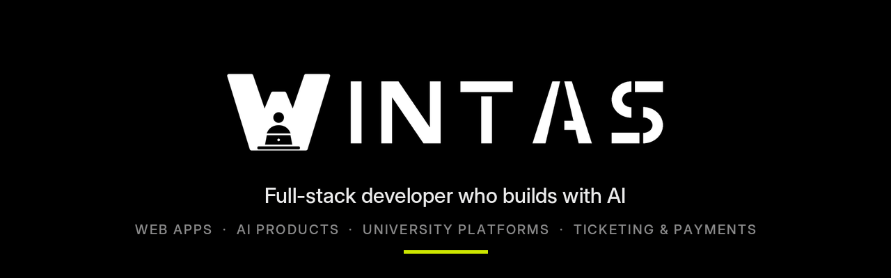

  

  
  
  
  

## Hi, I'm Nnanna (Wintas) 👋

I'm a Computer Science graduate (2026) and a full-stack developer who builds with AI, based in Imo State, Nigeria.

I've delivered a university e-library and website, a ticketing platform, a VTU payments app and an AI content bot, using AI as a core part of how I design, write and ship software. My goal is technology that is useful, polished and built to last.

- 🟢 **Available** for freelance work and collaboration
- 📄 **CV** in 10 languages: [download from my portfolio](https://wintas01.github.io/portfolio01/#about)
- 💬 **Reach me** by [email](mailto:nnannaokechukwu1@gmail.com) or [WhatsApp](https://wa.me/2347083066127)

## 🛠 Tools I build with

  
  
  
  
  
  
  
  
  
  
  
  
  
  
  
  

**Also:** AI integration (LLM APIs) · AI-assisted development · prompt engineering · UI/UX design

## 🚀 Featured work

| Project | What it is | Links |
|---|---|---|
| **KOMU E-Library** | University e-library for e-books, journals, theses and research databases. I built the frontend and backend. | [Live](https://komudigital.ng/) |
| **KOMU Website** | Team redesign of the official Kingsley Ozumba Mbadiwe University website (full-stack developer). | [Live](https://komu.edu.ng/) |
| **Tixora** | Event ticketing platform: find concerts and parties, pay your way, and enter with a QR code. | Launching soon |
| **VTU App** | Fast, simple top-ups: cheap data and airtime, electricity bills, TV and school fees. | [Live](https://sabuss.com/ojsub3) |
| **Church Auto Bot** | Generates posts and images with the Cloudflare AI API and auto-publishes them to Facebook. | [Demo](https://church-auto-bot-demo.vercel.app/) |
| **Neon Portfolio** | Free, open-source portfolio template: particle field, kinetic text, pinned scroll gallery. | [Demo](https://wintas01.github.io/portfolio01/templates/neon/) · [Code](https://github.com/wintas01/portfolio-template-1) |
| **ECHO Portfolio** | Free cinematic-scroll portfolio template with a starry-sky reveal and 3D project ribbon. | [Demo](https://wintas01.github.io/portfolio01/templates/echo/) · [Code](https://github.com/wintas01/portfolio-template-2) |
| **This portfolio** | My site: 10 languages, CVs that rebuild themselves from the project list, live GitHub activity. | [Live](https://wintas01.github.io/portfolio01/) · [Code](https://github.com/wintas01/portfolio01) |

---

Building useful, polished software, one project at a time.

